# Roadmap: Composable Pipeline & Chained Strategy Architecture

## 1. Executive Summary & Problem Diagnosis

Strategy and backtesting scripts in `vyapaar-examples` compose universe selection,
indicator computation, entry/exit signals, capital allocation, and execution through
reusable pipeline stages.

---

## 2. The Solution: Dual-Plane Chaining Architecture

Chaining is structured across **two complementary planes**:

```mermaid
flowchart TD
    subgraph PlaneA ["Plane A: Unix CLI Stream Chaining (Terminal / Shell)"]
        S1["08_screener_multibagger.py<br/>--format symbols / json"] -->|stdout | F1["11_filter_fundamentals.py<br/>--min-roce 15 --max-de 1.0"]
        S2["10_screener_value_dividend.py<br/>--near-52w-low --min-div 3.0"] -->|stdout | F1
        F1 -->|stdout | B1["09_backtest_sip.py<br/>--sip-amount 10000 --asof 2023-01-01"]
        F1 -->|stdout | B2["12_backtest_rebalance.py<br/>--freq monthly --equal-weight"]
    end

    subgraph PlaneB ["Plane B: Python Object Pipeline Chaining (In-Code DSL)"]
        US["Universe / Screener<br/>Multibagger / Value 52w Low"] --> QF["Quality Filter<br/>ROCE / Debt-to-Equity / FCF"]
        QF --> MR["Market Regime Guard<br/>Nifty > 200 SMA"]
        MR --> SG["Signal Generator<br/>Breakout / Pullback / SIP"]
        SG --> PS["Position Sizer<br/>Equal / Volatility / Fixed SIP"]
        PS --> RM["Risk Manager<br/>Trailing Stop / Drawdown Guard"]
        RM --> EX["Execution Harness<br/>Backtest / Paper / Live"]
    end
```

---

## 3. Composable Strategy Components (Pipeline Taxonomy)

Every strategy phase adheres to a lightweight, typed interface:

### 1. Screeners (`vyapaar_examples.pipeline.screeners`)
*Input: Catalog path, evaluation date `--asof` $\rightarrow$ Output: Ranked candidates with point-in-time metrics.*
- `MultibaggerScreener`: Stage 2 Momentum (1y return $>35\%$, Price $> \text{SMA}_{200}$ rising, within $20\%$ of 52w High).
- `ValueScreener`: Deep value (P/E $< 20$, P/B $< 2.0$, trading within $10\%$ of 52-week Low).
- `DividendYieldScreener`: High dividend yielders ($\ge 3.0\%$ cash dividend yield, positive FCF, within $15\%$ of 52-week Low).

### 2. Quality & Regime Filters (`vyapaar_examples.pipeline.filters`)
*Input: Candidates list $\rightarrow$ Output: Filtered candidates.*
- `FundamentalQualityFilter`: Filters by ROCE $\ge 15\%$, Debt/Equity $\le 1.0$, Operating Margin $> 0\%$.
- `MarketRegimeFilter`: Checks benchmark index (e.g. `NIFTY 50` trading above its 200-day SMA); inhibits new buys in bear regimes.
- `LiquidityFilter`: Filters out symbols with average daily turnover below a threshold (e.g. ₹5 Cr/day).

### 3. Sizing & Allocation (`vyapaar_examples.pipeline.sizing`)
*Input: Qualified symbols $\rightarrow$ Output: Target capital/weights per asset.*
- `FixedSipSizer`: ₹10,000/month per stock systematic investment.
- `EqualWeightSizer`: $1/N$ capital rebalancing allocation.
- `InverseVolatilitySizer`: Allocates inversely proportional to 30-day realized volatility or ATR.

### 4. Execution & Backtesting (`vyapaar_examples.pipeline.execution`)
*Input: Sized orders $\rightarrow$ Output: Trade journal, portfolio curve, PnL, XIRR.*
- `SipBacktestHarness`: Monthly/weekly rupee cost averaging simulation, terminal valuation, XIRR.
- `RebalanceBacktestHarness`: Periodic rebalance with Indian tax/cost model and drift threshold.
- `EventDrivenHarness`: Intraday/daily bar-by-bar event execution with T+1 settlement and next-open fills.
